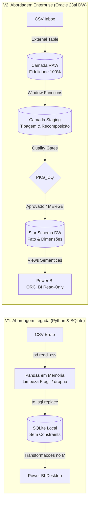
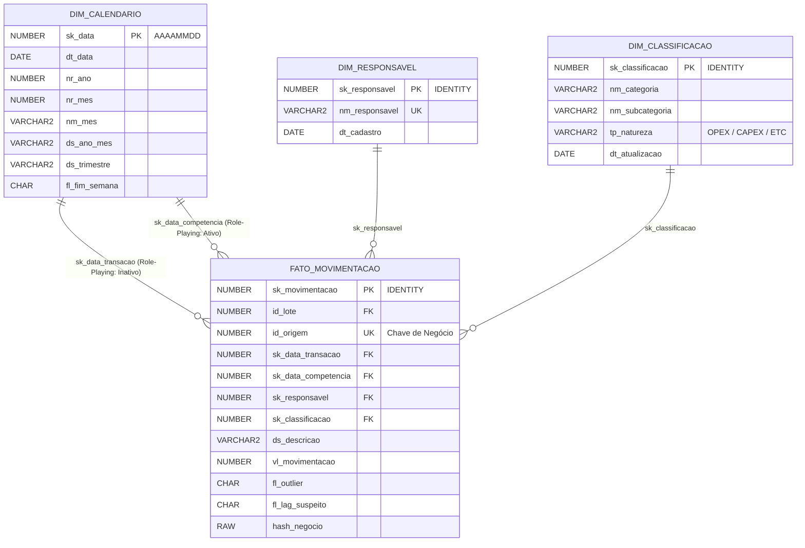

# 📊 Enterprise Data Engineering: Pipeline ETL de Gastos Domésticos em Oracle Database 23ai & Power BI

[](https://www.oracle.com/database/)
[](https://docs.oracle.com/en/database/oracle/oracle-database/23/lnpls/)
[](https://www.docker.com/)
[](https://powerbi.microsoft.com/)
[](LICENSE)
[](https://github.com/itsrafaelleal/oracle-etl-gastos-domesticos/actions/workflows/ci.yml)

> **Projeto de Engenharia de Dados de ponta a ponta:** Migração arquitetural completa de uma solução legada em Python/Pandas/SQLite para um pipeline ETL robusto, governado e auditável, com 100% das transformações e regras de negócio processadas no **Oracle Database 23ai** via **SQL orientado a conjuntos e packages PL/SQL**.

---

## 📌 Sumário Executivo
O objetivo deste projeto foi reestruturar um pipeline de dados pessoais acumulados ao longo de 5 anos (~4.000 transações financeiras reais), elevando a maturidade técnica da solução de um script analítico básico para uma arquitetura corporativa moderna de Data Warehouse.

A solução garante:
- **Processamento In-Database:** Zero dependência de Pandas/Polars ou Power Query para regras de negócio.
- **Rastreabilidade e Idempotência:** Armazenamento bruto na camada RAW e conciliação por hash SHA-256 via `MERGE`.
- **Governança e Qualidade:** Catálogo dinâmico de Data Quality Gates com barramento automático de cargas defeituosas (`ORA-20050`).
- **Observabilidade Forense:** Logs com `PRAGMA AUTONOMOUS_TRANSACTION` que sobrevivem a instruções de `ROLLBACK`.
- **Segurança RBAC:** Separação entre schema proprietário (`ORC_OWNER`) e usuário analítico somente leitura (`ORC_BI`).

---

## 🏛️ Comparativo de Arquitetura: Legado (V1) × Enterprise (V2)



| Dimensão Técnica | Arquitetura Legada (V1) | Arquitetura Atual (V2 - Oracle Database 23ai) |
| :--- | :--- | :--- |
| **Motor de ETL** | Python (Pandas) rodando no cliente | Oracle Database 23ai Engine (SQL Puro + PL/SQL) |
| **Ingestão** | `read_csv()` (falhava em registros partidos) | **External Tables (`ORACLE_LOADER`)** com leitura agnóstica de linha |
| **Camada RAW** | Inexistente (dados brutos descartados) | **`RAW_ORCAMENTO_LINHA`** append-only com hash SHA-256 e `id_lote` |
| **Tratamento de Quebras** | 49 transações corrompidas por `\r\n` | Recomposição por conjuntos via `SUM() OVER` + `LISTAGG` |
| **Controle de Qualidade** | Consultas manuais pós-carga | **Data Quality Gates (`PKG_DQ`)** com catalogue em banco e bloqueio |
| **Estratégia de Carga** | Sobrescrita total destrutiva (`replace`) | **`MERGE` incremental e idempotente** por chave de negócio |
| **Modelagem de Dados** | Tabelas relacionais sem integridade | **Star Schema** com membro desconhecido `-1` e FKs indexadas |
| **Auditoria e Logs** | Prints no console (voláteis) | **`CTL_LOG` com `PRAGMA AUTONOMOUS_TRANSACTION`** e backtrace |
| **Consumo de BI** | Power Query com lógica embutida | **Views `VW_BI_*`** semânticas consumidas por usuário restrito |

---

## 📐 Modelagem Dimensional (Star Schema)

A camada analítica adota um modelo em estrela (*Star Schema*) desnormalizado estrategicamente para eliminar ambiguidades de filtros e otimizar agregações no Power BI:



### Decisões Chave de Modelagem:
1. **Grão:** 1 linha na fato = 1 lançamento individual na planilha (menor nível disponível).
2. **`DIM_CLASSIFICACAO` Única:** Resolve o problema de subcategorias que se repetiam em categorias distintas (ex.: *Higiene* presente em *Moradia* e *Saúde*), eliminando relacionamentos circulares no Power BI.
3. **Membro Desconhecido `-1`:** Dimensões possuem registro padrão `-1` (`19000101` para data). Se uma chave falhar no lookup, a fato mantém o membro `-1` e não descarta o valor monetário.
4. **Role-Playing Dimension:** `DIM_CALENDARIO` gerada via SQL com `CONNECT BY LEVEL`, atuando como Competência (ativo) e Data da Compra (inativo via DAX `USERELATIONSHIP`).

---

## ⚡ Performance e Tuning Empírico

Como parte do compromisso de evitar tecnologias desnecessárias e fundamentar decisões técnicas, foi realizado um **benchmark comparativo real com 50.000 registros** no container Oracle:

| Estratégia de Processamento | Mecanismo de Execução | Tempo Total | Ganho de Performance |
| :--- | :--- | :--- | :--- |
| **Cursor Linha a Linha (Slow-by-Slow)** | `FOR r IN c_dados LOOP INSERT...` | **0.56 s** | Linha de Base (1.0x) |
| **PL/SQL BULK COLLECT + FORALL** | Processamento em blocos com arrays em memória | **0.14 s** | **4.0x mais rápido** |
| **SQL Orientado a Conjuntos (Set-Based)** | `INSERT /*+ APPEND */ INTO ... SELECT ...` direto | **0.27 s** | **2.1x mais rápido** |

> **Justificativa Arquitetural:** O processamento *Set-Based* foi adotado no pipeline por eliminar chaveamentos de contexto (*context switching*) entre as engines SQL e PL/SQL, dispensando alocação excessiva de memória PGA e aproveitando o caminho direto de escrita do CBO (*Direct-Path Insert*).

---

## 🛡️ Catálogo de Data Quality (Quality Gates)

O pipeline executa validações dinâmicas através da package `PKG_DQ` antes de autorizar qualquer inserção no DW:

- `DQ_VALOR_NULO` (**BLOQUEANTE**): Garante que nenhum lançamento financeiro entre sem valor monetário.
- `DQ_DATA_NULA` (**BLOQUEANTE**): Impede datas vazias ou corrompidas.
- `DQ_DESCRICAO_NULA` (**BLOQUEANTE**): Bloqueia registros com texto de descrição ausente.
- `DQ_DUPLICIDADE_CHAVE` (**BLOQUEANTE**): Identifica transações idênticas no mesmo lote e barra a carga.
- `DQ_OUTLIER_SUB` (**ALERTA**): Utiliza a média *Jackknife / Leave-One-Out* para sinalizar gastos que excedem 4x a média da subcategoria sem mascaramento estatístico.
- `DQ_LAG_FATURA_EXCESSIVO` (**ALERTA**): Sinaliza competências temporais deslocadas (> 12 meses).

---

## 📂 Estrutura do Repositório

```
oracle-etl-gastos-domesticos/
├── .env.example                # Variáveis de ambiente e senhas parametrizadas
├── docker-compose.yml          # Container Oracle Database 23ai Free
├── Makefile                    # Orquestrador de comandos automatizados
├── data/
│   ├── inbox/                  # Diretório montado no Oracle (DIR_ORC_INBOX)
│   └── sample/                 # Datasets sintéticos (60 remessas mensais + defeitos)
├── docs/                       # Documentação detalhada de arquitetura e design
│   ├── 01_contexto_e_evolucao.md
│   ├── 02_arquitetura.md
│   ├── 03_modelagem_dimensional.md
│   ├── 04_qualidade_de_dados.md
│   ├── 05_auditoria_observabilidade.md
│   ├── 06_performance.md
│   └── 07_power_bi.md
├── powerbi/
│   └── dax_measures.dax        # Catálogo de medidas DAX prontas para o dashboard
├── sql/
│   ├── install.sql             # Script mestre de instalação completa do banco
│   ├── 00_setup/               # Criação de usuários, diretórios e grants (SYSTEM)
│   ├── 01_ddl/                 # DDL de CTL, RAW, STG e DW (Star Schema)
│   ├── 02_packages/            # PKG_LOG, PKG_INGESTAO, PKG_STAGING, PKG_DQ, PKG_DW, PKG_PIPELINE
│   ├── 03_seed/                # Parâmetros, regras de DQ e geração do Calendário
│   ├── 04_views_bi/            # Views semânticas (VW_BI_*) com menor privilégio
│   ├── 05_analytics/           # Pareto 80/20, MoM com LAG, DENSE_RANK e Comparativos
│   └── 06_performance/         # Benchmarks de CPU/tempo e scripts EXPLAIN PLAN
├── tests/                      # Suíte de testes automatizados por etapa (00 a 09)
└── tools/
    └── gerador_dados_sinteticos/ # Gerador de fixtures sintéticas realistas
```

---

## 🚀 Como Executar o Projeto

### Pré-requisitos
- **Docker** e **Docker Compose** instalados no ambiente Linux/Homelab.
- **Make** e **Python 3** (para geração de fixtures).
- *Nenhum cliente Oracle local é obrigatório:* todos os scripts SQL e comandos `sqlplus` são executados dentro do container.

### Passo a Passo Rápido

1. **Configurar o ambiente:**
   ```bash
   cp .env.example .env
   # Edite senhas conforme desejado
   ```

2. **Iniciar o container Oracle 23ai:**
   ```bash
   make up
   make wait-healthy
   ```

3. **Criar schemas e diretórios (como SYSTEM):**
   ```bash
   make setup
   ```

4. **Gerar os dados sintéticos de teste:**
   ```bash
   make dataset
   ```

5. **Instalar a estrutura completa do banco (DDL, Packages, Seeds, Views):**
   ```bash
   make install
   ```

6. **Executar a suíte de testes ponta a ponta:**
   ```bash
   make test-all
   ```
   *(Executa os 10 testes unitários e de integração, validando privilégios, transações autônomas, recomposição de quebras, quality gates, idempotência de MERGE e segurança RBAC com 100% de sucesso).*

7. **Processar um lote pelo pipeline orquestrado:**
   ```bash
   make pipeline
   ```

---

## 📊 Conexão com o Power BI
1. Abra o **Power BI Desktop** e selecione o conector **Oracle Database**.
2. Servidor: `localhost:1521/FREEPDB1` (ou IP do seu servidor).
3. Autentique com o usuário analítico:
   - Usuário: `ORC_BI`
   - Senha: `${ORC_BI_PASSWORD}`
4. Importe as 4 views disponibilizadas:
   - `VW_BI_DIM_CALENDARIO`
   - `VW_BI_DIM_RESPONSAVEL`
   - `VW_BI_DIM_CLASSIFICACAO`
   - `VW_BI_FATO_MOVIMENTACOES`
5. Copie as fórmulas prontas do arquivo [`powerbi/dax_measures.dax`](powerbi/dax_measures.dax) para criar as métricas de Inteligência Temporal, Curva de Pareto e Ticket Médio.

---

## 🔄 Integração Contínua (CI)

O repositório possui um workflow de GitHub Actions (`.github/workflows/ci.yml`) que roda em cada push e PR para a `main`:

- **Guarda de dados reais:** falha o build se algum arquivo de dados financeiros (`.csv`, `.xlsx`, `.pbix`, `.dmp`, etc.) for versionado fora de `data/sample/`, reforçando automaticamente a política do `.gitignore` de nunca versionar dados reais.
- **Guarda de segredos:** falha se o `.env` for versionado por engano.
- **Smoke test:** valida a sintaxe do gerador de dados sintéticos no Python 3.12.

---

## ⚖️ Licença
Distribuído sob a licença [MIT](LICENSE). Consulte o arquivo `LICENSE` para mais detalhes.
