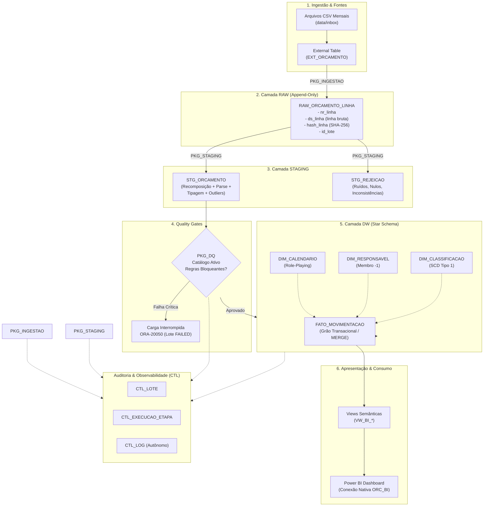

# 02. Arquitetura do Pipeline ETL

## 1. Topologia da Solução
A arquitetura do pipeline adota uma estrutura em camadas orientada a dados (*Medallion-style Architecture* adaptada para Data Warehousing relacional), centralizada no **Oracle Database 23ai**.

---

## 2. Responsabilidades por Camada

### 2.1 Camada de Ingestão (`EXT_ORCAMENTO`)
- **Tecnologia:** External Table com driver nativo `ORACLE_LOADER`.
- **Estratégia:** Leitura parametrizada via SQL dinâmico (`ALTER TABLE ext_orcamento LOCATION ('nome_arquivo.csv')`).
- **Resiliência:** Cada linha física do arquivo CSV é tratada como um único registro de texto (`ds_linha VARCHAR2(4000)`), acompanhada do pseudo-campo `RECNUM`. Nenhuma separação por ponto-e-vírgula é realizada na leitura física, impedindo falhas em quebras de linha embutidas.

### 2.2 Camada RAW (`RAW_ORCAMENTO_LINHA`)
- **Estratégia:** Armazenamento bruto append-only, fiel byte a byte ao conteúdo recebido.
- **Auditoria:** Gravação de `id_lote`, `nr_linha`, `hash_linha` via `STANDARD_HASH(ds_linha, 'SHA256')` e `dt_ingestao`.
- **Reprocessamento:** Permite recarregar ou auditar qualquer remessa sem depender do arquivo físico no disco.

### 2.3 Camada STAGING (`STG_ORCAMENTO` e `STG_REJEICAO`)
- **Recomposição por Conjuntos:** Utilização de Window Functions (`SUM() OVER (ORDER BY nr_linha)`) para identificar início de transações (`^\d+;`) e `LISTAGG` para fundir registros multilinhas.
- **Parse e Validação:** Extração posicional com `REGEXP_SUBSTR` tolerante a campos nulos e validação por conjuntos via `VALIDATE_CONVERSION`.
- **Segregação de Rejeições:** Lançamentos com valores nulos, datas inválidas ou ruídos de planilha (`;;;;;;;;;`) são direcionados para `STG_REJEICAO` com código de erro, descrição e severidade (`ERRO` ou `ALERTA`).

### 2.4 Camada de Qualidade de Dados (Quality Gates - `PKG_DQ`)
- **Catálogo Centralizado:** Tabela `CTL_DQ_REGRA` contendo as queries de teste parametrizadas com bind `:p_id_lote`.
- **Barramento de Segurança:** Regras classificadas como `BLOQUEANTE` interrompem o fluxo antes do DW, registrando histórico em `CTL_DQ_RESULTADO` e disparando exceção `ORA-20050`.

### 2.5 Camada de Data Warehouse (`DW`)
- **Modelagem Star Schema:** `FATO_MOVIMENTACAO` conectada a `DIM_CALENDARIO`, `DIM_RESPONSAVEL` e `DIM_CLASSIFICACAO`.
- **Idempotência com `MERGE`:** Inserção e atualização baseadas na chave de negócio (`id_origem`) e comparação de hash SHA-256 (`hash_negocio`). Se o arquivo for processado repetidamente, nenhuma linha é duplicada.
- **Membros Desconhecidos:** Registro padrão `-1` em todas as dimensões para garantir que nenhuma transação seja perdida por falha de relacionamento.

### 2.6 Camada Semântica de Consumo (`ORC_BI` e `VW_BI_*`)
- **Desacoplamento:** O Power BI consome unicamente as views `VW_BI_*`.
- **Segurança RBAC:** O usuário `ORC_BI` possui privilégio exclusivo de `SELECT` nas views, sendo impedido de ler ou alterar as tabelas físicas do Data Warehouse.
