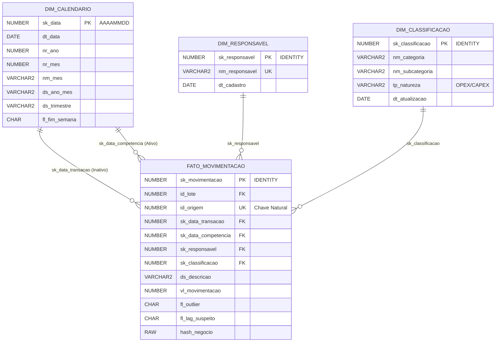

# 03. Modelagem Dimensional e Star Schema

## 1. Princípios de Design Adotados
A modelagem dimensional do projeto foi projetada para otimizar consultas analíticas no **Power BI**, eliminar complexidade excessiva e garantir integridade referencial estrita.

---

## 2. Decisões Arquiteturais Fundamentadas

### 2.1 Grão da Fato
- **Definição:** 1 linha na `FATO_MOVIMENTACAO` representa **um único lançamento financeiro realizado** (menor nível de granularidade disponível).
- **Justificativa:** Manter o nível atômico preserva a rastreabilidade total, permitindo tanto drill-down detalhado por transação individual quanto agregações dinâmicas de alto nível (mês, ano, categoria, responsável).

### 2.2 Desnormalização em `DIM_CLASSIFICACAO` (Star Schema vs Snowflake)
- **Problema no Modelo Original:** Subcategorias repetiam-se em diferentes categorias (ex.: *Higiene* aparecia em *Moradia*, *Pessoal* e *Saúde*), e o tipo (*OPEX*, *CAPEX*, etc.) dependia do par `(categoria, subcategoria)`. Em um modelo snowflake com tabelas normalizadas separadas, um filtro em "Higiene" causava ambiguidade no Power BI.
- **Solução:** Achatamento em uma única dimensão `DIM_CLASSIFICACAO (nm_categoria, nm_subcategoria, tp_natureza)` com constraint `UNIQUE (nm_categoria, nm_subcategoria)`.
- **Benefício:** Eliminação de joins múltiplos e filtros ambíguos no modelo semântico do Power BI, acelerando a renderização visual.

### 2.3 Role-Playing na `DIM_CALENDARIO`
- **Conceito:** A tabela fato possui duas datas com significados distintos:
  1. `sk_data_transacao`: Data física em que a compra ocorreu.
  2. `sk_data_competencia`: Mês/ano da fatura ou orçamento ao qual o gasto foi atribuído.
- **Implementação no Power BI:** 
  - Relacionamento **ativo** com `sk_data_competencia` (visão padrão de orçamento).
  - Relacionamento **inativo** com `sk_data_transacao` (ativado sob demanda via DAX `USERELATIONSHIP`).

### 2.4 Membro Desconhecido (`-1` / `19000101`)
- Em sistemas de produção, uma falha de lookup na carga da fato nunca deve descartar uma transação financeira.
- Cada dimensão possui pré-carregado um registro membro desconhecido com Surrogate Key `-1` (ou `19000101` para data). Se algum campo dimensional vier nulo ou inválido, a fato recebe `-1`, preservando o somatório monetário total e sinalizando a inconsistência para correção.

### 2.5 Tratamento de Mudança Dimensional (SCD Tipo 1)
- Como o escopo é o orçamento doméstico, correções na categorização ou no tipo de despesa representam correções retroativas de classificação. O `MERGE` em `DIM_CLASSIFICACAO` adota **SCD Tipo 1**, atualizando o tipo in-place para que todo o histórico reflita a taxonomia orçamentária correta.
